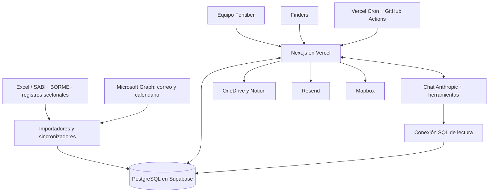

# War Room — Arquitectura

Revisado: **2026-10-23**, código de referencia `6e26851` (PR #190). Las métricas y versiones exactas se mantienen en [Estado actual](PROJECT_STATUS.md); el trabajo abierto, en [Roadmap](ROADMAP.md).

## 1. Qué resuelve

El War Room reúne el universo de empresas de PCI y seguridad electrónica en España, sus financieros, relaciones con grupos y personas, señales BORME y ejecución del funnel de adquisición. Es el CRM operativo de Fontiber; no depende de una sincronización con Pipedrive.

Hay dos zonas privadas y una publicación pública dentro del mismo despliegue:

- `warroom.fontiber.com`: equipo interno con mapa, tabla, grupos, Operaciones, pipeline, finders, usuarios, cuenta y monitorización.
- `portal.fontiber.com`: cada finder accede a sus targets, tareas, notas y propuestas con permisos restringidos.
- `/daily/YYYY-MM-DD`: resumen público que se enlaza desde los correos diarios.

## 2. Flujo general

Prisma accede a PostgreSQL desde el servidor. La app no utiliza Supabase Auth ni una API de datos directa desde el navegador. NextAuth gestiona las sesiones; RLS y la retirada de privilegios de los roles de la Data API cierran ese canal independiente de Prisma.

## 3. Producto y navegación

Las cuatro vistas de la portada comparten filtros, selección de empresa y ficha. La URL conserva el contexto; `hrefVista()` evita enlaces a rutas que no existen. El filtro de actividades combina PCI activa, PCI pasiva y seguridad electrónica con modos todas/cualquiera; `src/lib/actividades.ts` deriva el mismo dato para APIs, ficha y exportación a partir de sector, origen, RIPCI y pasiva. El sector histórico se conserva; ver [Actividades](ACTIVIDADES.md).

| Zona | Función |
|---|---|
| Mapa | Geografía, clusters con distribución CRM, selección por polígono y ficha |
| Tabla | Ordenación, filtros, selección y exportación Excel, incluido histórico financiero |
| Operaciones | Señales M&A y Alertas personas; Actividad reciente se integró en Señales |
| Grupos | Empresas y agregados por grupo |
| `/pipeline` | Kanban, leads anónimos, tareas y seguimiento de oportunidades |
| `/finders` y `/finders/proposals` | Equipo externo, accesos y revisión de propuestas |
| `/usuarios`, `/cuenta` | Invitaciones, activación, contraseña y preferencia de email diario |
| `/monitoring` | Ejecuciones de automatizaciones y sus contadores operativos |

El estado compartido del cliente vive en Zustand. Tras una mutación, el bus tipado `wr:data-changed` invalida las listas afectadas sin recargar toda la página. Las respuestas de datos son dinámicas; no se debe esconder una escritura reciente tras caché HTTP.

El mapa, la ficha, Operaciones y los tools del chat ya están divididos en módulos. Los antiguos refactors de estos componentes no son trabajo abierto.

## 4. Modelo de datos

| Bloque | Modelos y significado |
|---|---|
| Universo | `Empresa`, `Grupo`, `Financiero`; CIF único, sector, actividad transversal de pasiva, perímetro, localización, habilitaciones, RIPCI, Cepreven y estado SABI |
| Inteligencia jurídica | `BormeAlerta`, `PersonaCargo`, `BormePersona`; actos y cargos, con fuente y vigencia |
| CRM | `CrmEstado`, `CrmLog`, `Contacto`, `Nota`, `Tarea`; etapa, dueño, interlocutores y actividad |
| Equipo externo | `Finder`, `FinderNote`, `TargetProposal`, `FinderAccessLog` |
| Acceso y colaboración | `User`, tokens de recuperación, `Notificacion`, `Mencion`, `EmpresaSeenAt`, `ChatThread` |
| Ingesta y operación | cursores e ingestas de correo/calendario, `AuditLog`, `CronRun` |

`Tarea` sirve tanto para acciones pendientes como para actividad realizada. Las notas admiten respuestas y menciones; el timeline combina información de varios modelos y conserva el cursor de lectura por usuario.

Los nueve estados del CRM se definen en `lib/crm.ts`. Ausencia de CRM, situación legal, pertenencia a grupo y perímetro son ejes distintos. Una disolución no elimina la empresa del universo. Los leads anónimos son un mecanismo específico del pipeline y se vinculan a la entidad real cuando se conoce su identidad.

### Cuentas y estado SABI

La extracción SABI se cruza por CIF. Se guarda estado para todas las empresas encontradas y se cargan cuentas de activas y activas en concurso. `null` significa sin consultar; no encontrada no equivale a inactiva. La ficha avisa de situación no activa, cuentas antiguas o ausencia de información.

Ingresos se homogeneizan a **importe neto de la cifra de negocios** y GM a **Resultado bruto**. Los importes se convierten de miles de euros a euros. Los años rellenados enteramente con ceros no se consideran cuentas; los nulos no sustituyen datos existentes. El importador simula por defecto y aplica en una transacción con `--apply`.

### Registros y pasiva

RIPCI, habilitaciones de seguridad privada y Cepreven tienen semánticas propias. El sincronizador mensual aísla fallos por fuente y comunica altas o incidencias mediante un aviso conjunto.

La actividad de pasiva se guarda en `Empresa.proteccionPasiva` como booleano nullable: confirmada, revisión negativa o sin revisar. `pasivaServicios`, `pasivaEvidencias` y `pasivaRevisadaAt` conservan el detalle. No cambia sector, perímetro o CRM. Las listas lite/full comparten clasificación para filtro, tabla y mapa; ficha y exportación aportan las fuentes. El chat conoce esos campos. `scripts/import-pasiva.ts` cruza por CIF y audita los cambios en una transacción; ver [implementación e investigación](PROTECCION_PASIVA.md).

Las áreas Cepreven (`PAS-COMP`, `PAS-REAC`, `PAS-ESTR`) permanecen separadas de la actividad declarada. Ni una fuente asociativa ni la marca de pasiva otorgan calificación. La ausencia de revisión no descarta actividad y la clasificación no es todavía exhaustiva.

## 5. Automatizaciones e integraciones

La definición ejecutable está en `vercel.json` y `.github/workflows/`; la tabla de horarios se mantiene en [Operación](OPERATIONS.md).

- **BORME:** descarga y clasificación del boletín del día; detección de señales y actualización de cargos. Los alias de grupos ayudan a resolver denominaciones. Las señales no deben confundirse con prueba definitiva de una compra.
- **Correo y calendario:** GitHub Actions llama endpoints protegidos de la app. Microsoft Graph cruza interlocutores con `Contacto`; solo los mensajes/eventos relevantes generan registros. Correo incluye entrada y salida, con deduplicación por identificadores de origen. Los cambios de calendario conservan las ediciones manuales de tareas.
- **Documentación:** vinculación por nombre legal/comercial y creación de carpeta estándar en OneDrive y página Notion para las etapas que lo requieren.
- **Emails:** resumen BORME, digest de tareas y actividad de finders, notificaciones e invitaciones/recuperación. El resumen diario respeta `User.emailDiario`.
- **Registros:** Cepreven, seguridad privada y RIPCI se refrescan juntos cada mes. Una fuente fallida no impide procesar las demás.

No hay webhooks de Microsoft: se consulta mediante polling con cursores. Los eventos recurrentes de calendario se ingieren como serie; no hay una tarea por ocurrencia. Es una limitación vigente, no una migración programada.

## 6. Chat

El endpoint autentica al usuario interno y compone doce herramientas:

| Dominio | Herramientas |
|---|---|
| Consulta | `execute_sql`, `buscar_empresa`, `buscar_texto`, `movimientos_grupo` |
| Tareas | `crear_tarea`, `actualizar_tarea` |
| Contactos | `buscar_contacto`, `crear_contacto`, `actualizar_contacto` |
| CRM | `cambiar_etapa` |
| Finders | `actividad_finders`, `resumen_actividad_finders` |

El chat usa streaming, hilo persistido por usuario y un prompt con esquema y reglas de uso. La fecha actual se añade por petición fuera del prompt estático cacheado. Sin periodo indicado, responde con el histórico disponible y explica su alcance.

`movimientos_grupo` reconstruye incorporaciones a partir de BORME: la empresa no guarda fecha de entrada a un grupo. Devuelve evidencia y casos dudosos. `buscar_texto` cubre notas, tareas, correos, reuniones, fichas, contactos y registros relacionados, con normalización de tildes.

`execute_sql` tiene dos barreras: validación de una sola sentencia de lectura y conexión con `warroom_chat_readonly`. El rol restringe tablas/columnas sensibles y duración de consulta. En `User` y `Finder` los permisos son por columna, excluyendo hashes. El atributo `BYPASSRLS` permite leer las tablas cuya Data API está cerrada; no concede escritura. El código conserva fallback a la conexión normal si falta `CHAT_READONLY_DATABASE_URL`: cada entorno debe configurarla expresamente.

Las herramientas que sí escriben utilizan los servicios de aplicación con autoría y auditoría; no escriben mediante SQL generado por el modelo.

## 7. Seguridad y portal

NextAuth separa `admin` y `finder`. Las cuentas del equipo viven en `User`, se invitan desde la app y el acceso se revalida contra su estado activo. El fallback de credenciales de entorno solo sirve a los usuarios originales hasta fijar su contraseña propia.

El portal combina control del middleware, guards de página y autorización de endpoints. Un finder solo ve targets asignados y no anónimos. No recibe financieros, grupo, owner, BORME, etapa interna ni notas internas no compartidas. Las etapas se agrupan para el portal. El autocomplete de propuestas muestra nombre y CIF como excepción específica, sin desvelar seguimiento interno.

La edición propia se limita a 24 horas; completar tareas tiene sus propias reglas. Las propuestas no revelan duplicados al finder. Activar/desactivar y revocar sesiones son controles distintos; rotar contraseña también invalida sesiones anteriores. Las acciones del finder dejan trazabilidad y las mutaciones relevantes, auditoría.

Crons exigen `CRON_SECRET` y fallan cerrados si no existe. Los secretos se configuran por entorno, nunca se documentan sus valores. La publicación `/daily` es pública por diseño; no debe contener campos reservados a la operativa privada.

## 8. Entrega y mantenimiento

La CI valida migraciones en PostgreSQL temporal, tests, TypeScript y build. Cada PR genera preview en Vercel; `main` es la referencia de producción. La relación entre migración y código debe planificarse para que ninguna versión lea columnas aún inexistentes.

`CronRun` registra estado, duración y contadores; el panel de operación y los avisos permiten investigar fallos. El logger estructurado y Vercel Analytics/Speed Insights ya están incorporados.

Actualizar esta arquitectura al cambiar fuentes, permisos, flujos o modelos. Mantener las cifras en un único corte fechado, los comandos operativos en Operación y las prioridades en Roadmap. Consultar Git/PR para el historial; no conservar una lista paralela de tareas antiguas.

## Cambios de esta revisión

| Fecha | Alcance |
|---|---|
| 2026-10-23 | Sustituido el documento acumulativo de abril por el estado comprobado: CRM propio, usuarios en BD, chat modular, SABI, registros, automatizaciones y seguridad. Retirados recuentos sin fecha y pendientes ya implementados. |
